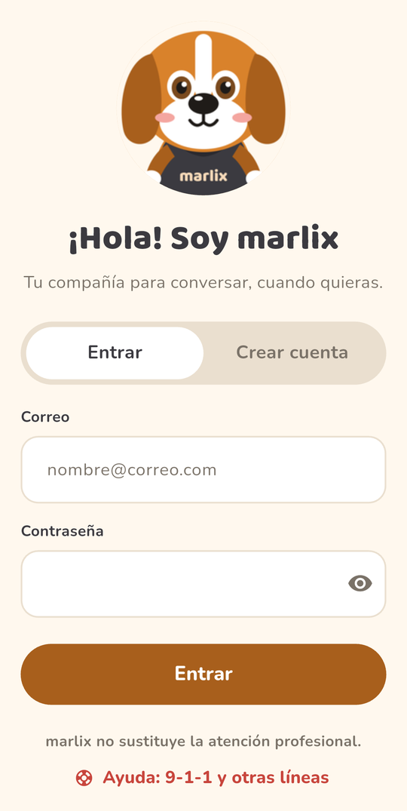
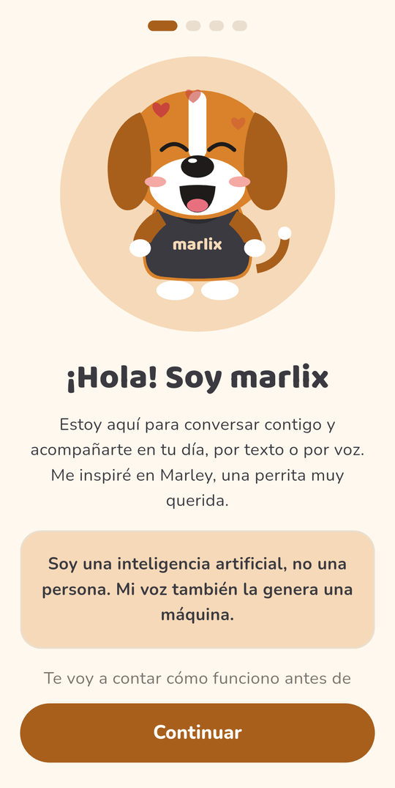
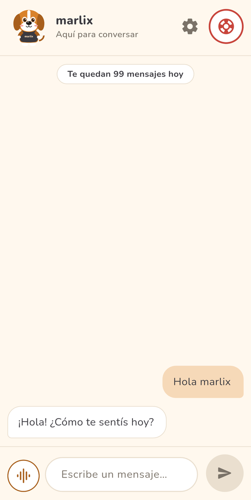
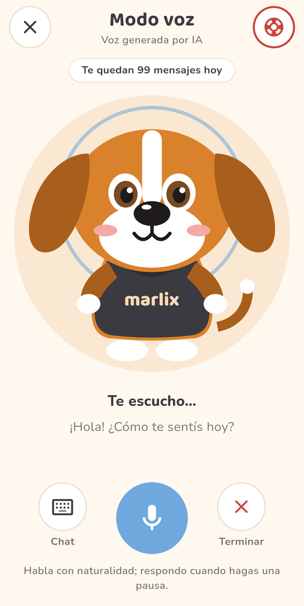
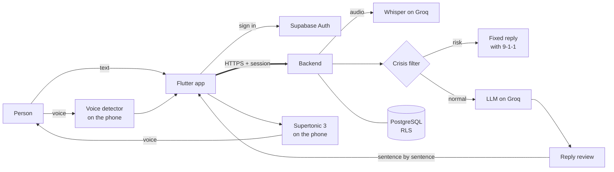

<p align="center">
  
</p>

<h1 align="center">marlix</h1>

<p align="center">
  Open source mobile app for conversational companionship with an AI avatar that listens, speaks and remembers.
</p>

<p align="center">
  <a href="https://github.com/WGuillenDev/marlix/actions/workflows/ci.yml"></a>
  <a href="LICENSE"></a>
</p>

<p align="center">
  
  
  
  
  
  
  
  
  
</p>

> **marlix is not therapy and does not replace professional mental health care.**
> In Costa Rica, call **9-1-1** (free, 24/7) for psychological support.

---

## Screenshots

<p align="center">
  
  
  
  
</p>

<p align="center">
  <sub>Sign in · Onboarding with the AI notice · Chat · Voice mode. Taken on a Samsung Galaxy S24 Ultra.</sub>
</p>

---

## Description

**marlix** keeps people company through conversation. It is designed for people facing social isolation who need accessible emotional support, and it does so without fostering dependency: it encourages them to connect with the people in their lives. The person can write or simply talk, and marlix answers with its own voice, generated on the phone, through an animated avatar inspired by Marley, a much-loved dog.

Safety comes before the model: every message goes through a crisis filter before reaching the LLM, a person at risk gets a fixed reply with 9-1-1 first, and every reply of the model is reviewed before it reaches the person. The v1 is for personal and family use, free, with one avatar and zero operating cost, and it is ready to scale without rewriting code.

---

## Features

| Module | What it does |
| --- | --- |
| **Chat** | Conversation with marlix, with a saved history paged by the backend. The model sees the last 16 messages of the open conversation and never the ones of a crisis. |
| **Voice mode** | Full-screen conversation without buttons: a voice detector on the phone knows when the person stops talking, Whisper transcribes it, and marlix replies sentence by sentence while the answer is still being written. The person can interrupt it at any time. |
| **marlix's voice** | Supertonic 3 runs on the phone, with natural pauses and the avatar's mouth following the volume. The native voice is the fallback. |
| **Distilled memory** | When a conversation ends, a background job keeps lasting facts about the person. The person sees, edits and deletes them in "Lo que marlix sabe de mí". |
| **Crisis filter** | Two layers before the model (keywords and an isolated classifier). A crisis gets the fixed reply with 9-1-1 and the model is never called. |
| **Help screen** | 9-1-1 and other lines one tap away, also without internet. |
| **Animated avatar** | Five states (resting, listening, thinking, speaking, happy) that follow the conversation. |
| **Onboarding** | The AI notice, the reminder that marlix does not replace professional care, the explicit data consent, the microphone permission and the reminders offer, once per account. |
| **Account and data** | Sign up (18 or older, enforced by the database), messages deleted after 90 days, and the whole account deleted in cascade on request. |

### User experience

- Daily reminders at the time the person chooses, with a different warm text each day and no streaks or counters, so they never guilt-trip.
- A clear daily limit that warns when few messages are left and says when they renew.
- Error states for no internet, a sleeping server and the daily limit, so the app never stays silent.
- The avatar rests when the phone asks to remove animations.
- Everything in Spanish, with the Costa Rican vocabulary passed to the transcription.

---

## Technologies

| Technology | Use in the project |
| --- | --- |
| **Flutter + Riverpod** | Android app: chat, voice mode, avatar, onboarding and help screen. |
| **Node.js 24 + Express 5 + TypeScript** | Backend in strict mode with ESM, validated with zod and tested with `node:test`. |
| **Supabase (PostgreSQL)** | Accounts, history, memory and usage, with RLS on every table and minimum grants per role. |
| **Groq** | The chat model, the crisis classifier, the memory extractor and Whisper, with Zero Data Retention on. |
| **Supertonic 3** | marlix's voice, generated on the phone. |
| **Silero VAD** | Voice and turn detection on the phone, so voice mode needs no buttons. |
| **Render** | Hosting of the backend, deployed only when the CI passes. |
| **GitHub Actions** | CI for the backend, the app and the database on every pull request. |

### External services

| Service | Purpose |
| --- | --- |
| [Groq](https://groq.com/) | LLM for the conversation (`openai/gpt-oss-120b`), the crisis classifier and the memory extractor, and Whisper for speech recognition. |
| [Supabase](https://supabase.com/) | Auth and PostgreSQL database. |
| [Render](https://render.com/) | Backend hosting on the free plan. |
| [Hugging Face](https://huggingface.co/Supertone/supertonic-3) | Download of the Supertonic 3 voice model on first use. |

---

## Architecture

```
marlix
 ┣ 📂 app                     Flutter app
 ┃ ┣ 📂 lib
 ┃ ┃ ┣ 📂 screens             Chat, voice mode, onboarding, help, settings and memories
 ┃ ┃ ┣ 📂 services            API client, auth, voice (TTS, VAD, recording) and reminders
 ┃ ┃ ┣ 📂 models              Typed data from the backend
 ┃ ┃ ┗ 📂 widgets             The animated avatar and shared pieces
 ┃ ┣ 📂 assets                Avatar layers, fonts and configuration
 ┃ ┗ 📂 config                Backend URL and Supabase project per environment
 ┣ 📂 api                     Node + TypeScript backend
 ┃ ┣ 📂 src
 ┃ ┃ ┣ 📂 routes              The v1 endpoints
 ┃ ┃ ┣ 📂 services            LLM, crisis filter, chat, memory, usage and transcription
 ┃ ┃ ┣ 📂 middleware          Session, security headers and errors
 ┃ ┃ ┗ 📂 config              Environment validation and the system prompt
 ┃ ┗ 📂 config                Help resources and usage plans
 ┣ 📂 docs                    Design, contract, decisions, schema and migrations
 ┣ 📂 infra                   Local development config (pgAdmin)
 ┣ 📄 docker-compose.yml      Local database
 ┗ 📄 render.yaml             Backend deployment
```

### Data flow



The full diagram, with where each key lives, is in [docs/architecture.md](docs/architecture.md).

### Technical decisions

- **The app never talks to the LLM:** only the backend holds the Groq key, and every message goes through the session check, the daily limit and the crisis filter first.
- **Safety before the model:** a crisis never reaches the LLM; the reply is fixed and the activation is logged without content.
- **Voice on the phone:** Supertonic 3 generates marlix's voice on the device, so speaking costs nothing and the text never leaves the phone to become audio.
- **Echo handled by the phone:** marlix speaks through the call audio route, so the phone cancels its own voice and the microphone can stay open to let the person interrupt.
- **Streaming for voice:** in voice mode the reply arrives by Server-Sent Events, one reviewed sentence at a time, and the first sound comes before the whole answer is written.
- **Data the person controls:** RLS on every table, the backend writes with the service key, messages expire after 90 days and the memory can be edited or deleted.
- **Zero operating cost:** Groq's free plan, Render's free plan, Supabase's free tier and voice on the device.

Every choice, with the options that were discarded, is in [docs/decisions.md](docs/decisions.md).

---

## Getting started

### App

Requirements: [Flutter](https://docs.flutter.dev/get-started/install) stable (3.47 or later) and [Android Studio](https://developer.android.com/studio) with an Android emulator, or an Android phone over USB with developer mode on.

1. Install the dependencies:
   ~~~bash
   cd app
   flutter pub get
   ~~~
2. Start an emulator from Android Studio (**Device Manager → ▶**) and run the app against the production backend:
   ~~~bash
   flutter run --dart-define-from-file=config/production.json
   ~~~

The backend URL and the Supabase project are not in the code: they come from a file in `app/config/`, and the app refuses to start without valid ones. The app uses Supabase only to sign up and sign in, with the project's publishable key, which is public by design; the secret key never goes in the app.

| File | Backend | In Git |
|---|---|---|
| `config/production.json` | https://marlix-api.onrender.com | Yes |
| `config/local.json` | Your own backend (`npm run dev`), copied from `config/local.example.json`. From the emulator, your computer is `10.0.2.2`. Use the same `SUPABASE_URL` and `SUPABASE_PUBLISHABLE_KEY` as `config/production.json`. | No |

Plain `http` is only accepted in debug builds, for a backend on your computer; a release build always uses HTTPS.

The app opens on the sign-in screen. Create an account there (you must be 18 or older); the session is kept, encrypted, until you sign out in **Ajustes**. There you can also delete the account and all its data for good; it asks for your password again if you signed in more than 5 minutes ago.

| Command (in `app/`) | What it does |
|---|---|
| `flutter analyze` | Checks the code with the project's lint rules. |
| `flutter test` | Runs the automated tests. The [CI](.github/workflows/ci.yml) also runs them, with the format check and `flutter analyze`, on every pull request. |
| `flutter test integration_test --dart-define-from-file=config/local.json` | Calls every backend endpoint from the app on the emulator. It signs up its own throwaway account (`it-…@marlix.test`) and deletes it with `DELETE /v1/account` at the end, even if a test fails, so it leaves no data in the database. It sends two chat messages; one uses the Groq quota. |
| `flutter build apk --release --dart-define-from-file=config/production.json` | Builds the release APK against production. Test voice mode on a release build too: R8 shrinks it and the debug build does not. |
| `dart format lib test integration_test` | Formats the code (100 columns). |

### Backend

Requirements: [Node.js](https://nodejs.org/) 24 or later.

1. Install the dependencies and copy the example environment file:
   ~~~bash
   cd api
   npm install
   cp .env.example .env
   ~~~
   Then fill in `GROQ_API_KEY` and the Supabase variables.
2. Start the server with automatic reload:
   ~~~bash
   npm run dev
   ~~~
3. Check that it answers:
   ~~~bash
   curl http://localhost:3000/health
   # {"status":"ok"}
   ~~~
4. Every `/v1` request except the help resources needs a session. Sign in to Supabase Auth with an account created in the app; `access_token` in the answer is the token, valid for one hour:
   ~~~bash
   curl -X POST "https://<project-ref>.supabase.co/auth/v1/token?grant_type=password" \
     -H "apikey: <SUPABASE_PUBLISHABLE_KEY>" \
     -H "Content-Type: application/json" \
     -d '{"email": "<your email>", "password": "<your password>"}'
   ~~~
5. Send a message to marlix with that token:
   ~~~bash
   curl -X POST http://localhost:3000/v1/chat \
     -H "Content-Type: application/json" \
     -H "Authorization: Bearer <access_token>" \
     -d '{"message": "Hola, hoy tuve un buen día"}'
   ~~~
   The response follows the [API contract](docs/api-contract.md#post-v1chat).

The server validates these variables when it starts. If a required one is missing or invalid, it does not start and prints the name of the variable (never its value).

| Variable | Required | Default | What it is |
|---|---|---|---|
| `PORT` | No | `3000` | Port the API listens on. |
| `LLM_PROVIDER` | No | `groq` | LLM provider that answers the chat. Only `groq` exists for now; see [how to add one](docs/architecture.md#adding-an-llm-provider). |
| `LLM_TIMEOUT_MS` | No | `15000` | Milliseconds to wait for one LLM call. Timeouts, network errors and 5xx are retried once; quota and key errors are not. |
| `GROQ_API_KEY` | Yes | — | Groq API key, from [console.groq.com/keys](https://console.groq.com/keys). Only the backend holds it. |
| `GROQ_MODEL` | Yes | `openai/gpt-oss-120b` | Model used for the conversation. Groq retires models: change it here, not in code. |
| `GROQ_BASE_URL` | No | `https://api.groq.com/openai/v1` | Groq's OpenAI-compatible endpoint. Only changed for tests. |
| `GROQ_REASONING_EFFORT` | No | `low` | Reasoning effort for gpt-oss models (`low`, `medium`, `high`), or `none` for models that do not reason. |
| `CRISIS_CLASSIFIER_MODEL` | No | `openai/gpt-oss-20b` | Model that classifies ambiguous messages for the [crisis protocol](docs/crisis-protocol.md#the-second-layer). Different from the chat model, so it has its own quota. |
| `CRISIS_CLASSIFIER_TIMEOUT_MS` | No | `5000` | Longest wait for that classification. A timeout counts as a crisis. |
| `CHAT_CONTEXT_MESSAGES` | No | `16` | How many of the last messages of the conversation the model sees with each new one (2 to 40). Each one costs tokens of Groq's free quota: lower it if the limit is reached. |
| `CHAT_MEMORY_FACTS` | No | `30` | How many of the person's saved [memories](docs/memory.md#what-goes-into-the-prompt) go into the prompt with each message (1 to 50); if there are more, the most recently updated ones. |
| `CONVERSATION_IDLE_MINUTES` | No | `30` | A conversation without messages for this long has ended, and that starts the extraction of its [memory](docs/memory.md) (1 to 1440). |
| `MEMORY_EXTRACTOR_MODEL` | No | `openai/gpt-oss-20b` | Model that extracts the facts of a finished conversation. Smaller than the chat model, so the extractions do not use the chat's quota. |
| `MEMORY_EXTRACTOR_TIMEOUT_MS` | No | `30000` | Longest wait for one extraction. A failed one stays pending and is tried again. |
| `MESSAGE_RETENTION_DAYS` | No | `90` | Raw messages older than this are deleted by a job that runs every hour (1 to 3650). The distilled memory is kept as long as the account; see the [policy](docs/memory.md#how-long-messages-are-kept). |
| `SUPABASE_URL` | Yes | — | The Supabase project URL, `https://<project-ref>.supabase.co`, without the `/rest/v1` that Project Settings → Data API shows. Session tokens are checked against this project's public signing keys. |
| `SUPABASE_SECRET_KEY` | Yes | — | Supabase secret key, starting with `sb_secret_` (Project Settings → API Keys). It has `service_role` rights and bypasses RLS: only the backend holds it. Never share it. |

| Command | What it does |
|---|---|
| `npm run dev` | Starts the server and restarts it on every change. |
| `npm run typecheck` | Checks the types in strict mode without emitting files. |
| `npm test` | Runs the automated tests. The [CI](.github/workflows/ci.yml) also runs them, with the type check and the build, on every pull request. |
| `npm run llm:smoke` | Sends one real message to the configured LLM and prints the reply. `-- --burst 6` sends several at once to check that a quota error (429) is handled. Spends real quota. |
| `npm run crisis:eval` | Runs the crisis test cases through the real filter, classifier included, and reports false negatives and false positives. Spends real quota. |
| `npm run build` | Compiles TypeScript to `dist/`. |
| `npm start` | Runs the compiled server from `dist/`. |

### Deployment

The backend runs on [Render](https://render.com) (free plan), defined in [`render.yaml`](render.yaml). Every push to `main` that changes `api/` deploys automatically, once the [CI](.github/workflows/ci.yml) checks of that commit pass; a commit with a failed check is never deployed.

Usage limits: 100 replies a day per person, resetting at midnight Costa Rica time, and 5 messages per minute. The daily count and cap live in the database (`daily_usage` and `plan_limits`), so a restart does not reset them and the cap changes without a deploy; the per-minute limit is in [`api/config/plans.json`](api/config/plans.json). Reaching one answers `429`, as described in the [API contract](docs/api-contract.md#errors).

**Production URL:** https://marlix-api.onrender.com

| Endpoint | Access |
|---|---|
| `GET /health` | Public. Used by the uptime monitor; says `degraded` if the usage counter fails. |
| `GET /v1/help-resources` | Public. The help resources the app shows, from `api/config/crisis.json`. |
| Rest of `/v1/*` | Only with a Supabase session, `Authorization: Bearer <access token>`; anything else gets `401`. Each account has its own daily limit. |

The free plan sleeps the service after about 15 minutes without traffic, so the first request after a pause can take up to a minute.

To create the service the first time: in the Render dashboard, **New → Blueprint**, pick this repository and confirm. Render asks for `GROQ_API_KEY` (use a production key, not your local one), `SUPABASE_URL` and `SUPABASE_SECRET_KEY`.

### Supabase project

Production data and accounts live in the Supabase project. Changes to the schema after it was created are in [`docs/migrations/`](docs/migrations/): run each file once, in order, in the **SQL Editor**. [`docs/schema.sql`](docs/schema.sql) already includes them for a new database.

Sign-up uses email and password, with these settings in **Authentication → Sign In / Providers → Email** ([decision](docs/decisions.md)):

| Setting | Value | Why |
|---|---|---|
| Confirm email | Off | The free email service sends about 2 emails an hour; confirmation comes with its own card (S7-9). |
| Minimum password length | 8 | The same minimum the app checks. |

The minimum age is enforced in the database: the sign-up trigger in the schema refuses anyone under 18, whatever client calls Supabase Auth.

### Local database

The database runs locally in Docker with the same Postgres image Supabase uses in production, so [`docs/schema.sql`](docs/schema.sql) behaves the same as in the cloud. Production runs on Supabase cloud; Docker is only for development.

Requirements: [Docker Desktop](https://www.docker.com/products/docker-desktop/) running.

1. Copy the example environment file and set your own passwords:
   ~~~bash
   cp .env.example .env
   ~~~
2. Start the database and pgAdmin:
   ~~~bash
   docker compose up -d --wait
   ~~~
   On the first start, with an empty volume, the schema in `docs/schema.sql` is applied automatically.

| Service | Address | User | Password |
|---|---|---|---|
| PostgreSQL | `localhost:54322`, database `postgres` | `postgres` | `POSTGRES_PASSWORD` in `.env` |
| pgAdmin | http://localhost:5050 | `PGADMIN_EMAIL` in `.env` | `PGADMIN_PASSWORD` in `.env` |

In pgAdmin the server **marlix (local)** is already registered; it asks for `POSTGRES_PASSWORD` the first time you open it. The tables are under *Databases → postgres → Schemas → public → Tables*.

| Command | What it does |
|---|---|
| `docker compose down` | Stops everything. The data is kept. |
| `docker compose down -v` | Stops everything and deletes the data. The next start applies the schema again from scratch. |
| `docker compose logs db` | Shows the database logs. |
| `docker compose exec -T db psql -U postgres -d postgres -v ON_ERROR_STOP=1 -f - < docs/schema-test.sql` | Runs the privilege and RLS tests. Prints `All database tests passed.` and changes nothing. |

Both services only listen on `127.0.0.1`, and the data lives in Docker volumes outside the repository.

---

## Project status

```
🟡 In development: Sprint 7 (closing) of 7
```

- [x] Sprint 0: design (user stories, use cases, wireframes, ERD, architecture, API contract and system prompt)
- [x] Sprint 1: backend base on Render with the LLM layer
- [x] Sprint 2: crisis filter, reply review and usage limits
- [x] Sprint 3: the chat app and the help screen
- [x] Sprint 4: accounts, history and distilled memory
- [x] Sprint 5: the animated avatar, onboarding and daily reminders
- [x] Sprint 6: voice, with marlix's own voice and a voice mode that can be interrupted
- [ ] Sprint 7: tests, the signed APK, backups and monitoring

The app is not shared yet. Every change by sprint is in the [changelog](CHANGELOG.md), and the [CI](.github/workflows/ci.yml) tests the backend, the app and the database on every pull request.

---

## Documentation

Design documents for v1, in the order they are usually read:

| Document | What it contains |
|---|---|
| [User stories](docs/user-stories.md) | What v1 does, as user stories with acceptance criteria and their backlog cards. |
| [Use cases](docs/use-cases.md) | UML use case diagram: actors, use cases and how they relate. |
| [Wireframes and visual style](docs/diagrams/wireframes/README.md) | Screens, navigation flow, color palette, typography and the avatar. |
| [Architecture](docs/architecture.md) | How the app, backend, Supabase, Groq and on-device voice fit together, and where the keys live. |
| [Entity-relationship diagram](docs/erd.md) | Data model, relationships, access rules and RLS. The SQL is in [`schema.sql`](docs/schema.sql). |
| [Chat sequence](docs/diagrams/chat-sequence.md) | Every step of sending a message, including the crisis filter and the daily limit. |
| [API contract](docs/api-contract.md) | Every v1 endpoint with its request, response, errors and examples. |
| [System prompt](docs/system-prompt.md) | marlix's personality, how memory is injected and the test conversations. |
| [Distilled memory](docs/memory.md) | How a finished conversation becomes lasting facts about the person, what is never saved and the limits. |
| [Crisis protocol](docs/crisis-protocol.md) | How the crisis filter classifies each message before the model, and what the crisis reply contains. |
| [Technical decisions](docs/decisions.md) | Each choice between technical options, what was discarded and why. |

Rules every change must follow are in [CONTRIBUTING.md](CONTRIBUTING.md); security reporting is in [SECURITY.md](SECURITY.md).

---

## Contributing

See [CONTRIBUTING.md](CONTRIBUTING.md).

## License

[MIT](LICENSE)

### Third-party models

marlix's voice is [Supertonic 3](https://huggingface.co/Supertone/supertonic-3) by Supertone Inc. (Copyright (c) 2026 Supertone Inc.). Its model weights are under the [OpenRAIL-M License](https://huggingface.co/Supertone/supertonic-3/blob/main/LICENSE), which allows commercial use and includes use restrictions that apply to anyone who uses the model; its sample code is MIT. The app downloads the model on first use; it is not part of this repository. See the [decision](docs/decisions.md#2026-10-21--voice-supertonic-3-on-the-phone-voice-f4-s6-1).

---

## Author

**[WGuillenDev](https://github.com/WGuillenDev)**<br>
Junior Software Engineer · Costa Rica
