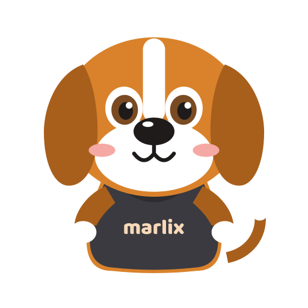
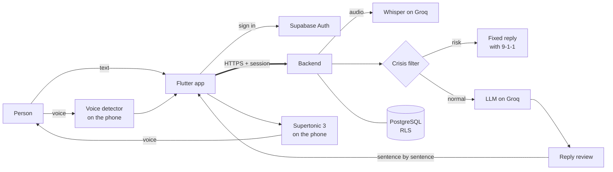
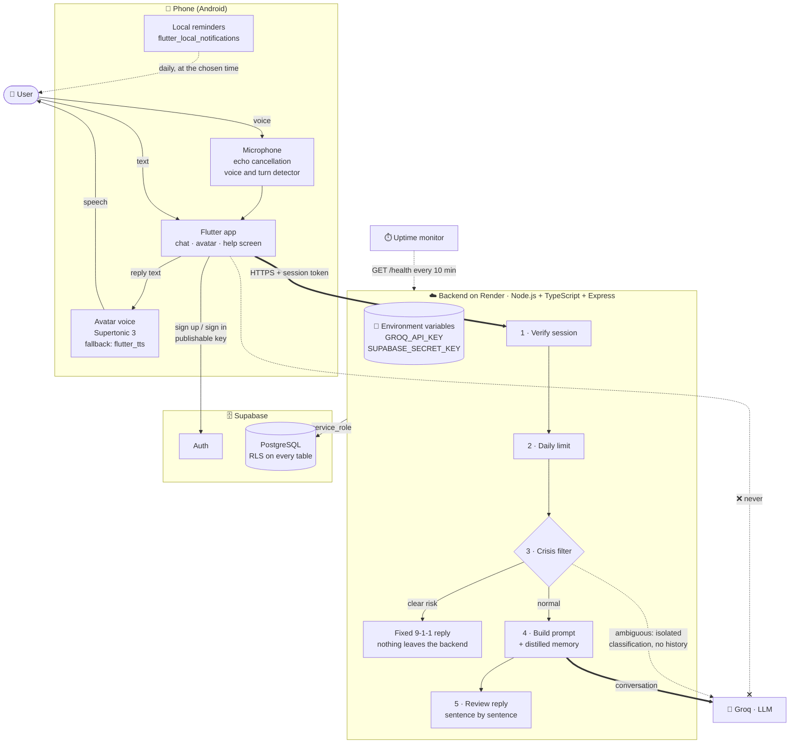

<p align="center">
  
</p>

<h1 align="center">marlix</h1>

<p align="center">
  Open source mobile app for conversational companionship with an AI avatar that listens, speaks and remembers.
</p>

<p align="center">
  <a href="https://github.com/WGuillenDev/marlix/actions/workflows/ci.yml"></a>
  <a href="LICENSE"></a>
  
  
</p>

<p align="center">
  <a href="#about">About</a> ·
  <a href="#features">Features</a> ·
  <a href="#how-it-works">How it works</a> ·
  <a href="#tech-stack">Tech stack</a> ·
  <a href="#getting-started">Getting started</a> ·
  <a href="#documentation">Documentation</a>
</p>

> [!IMPORTANT]
> marlix is not therapy and does not replace professional mental health care. In Costa Rica, call **9-1-1**.

## About

marlix keeps people company through conversation. It is designed for people facing social isolation who need accessible emotional support, and it encourages them to connect with the people in their lives instead of depending on the app. The person writes or simply talks, and marlix answers with its own voice through an animated avatar.

Safety comes before the model: every message passes a crisis filter before it reaches the LLM, a person at risk gets a fixed reply with 9-1-1, and every reply is reviewed before it is shown.

**Goal of v1:** personal and family use, free, with one avatar and zero operating cost, built to scale (more avatars, a paid plan) without rewriting code.

## Features

| | |
| --- | --- |
| 💬 **Chat** | Conversation with a saved history and context of the open conversation. |
| 🎙️ **Voice mode** | Hands-free: marlix knows when the person stops talking, answers sentence by sentence and can be interrupted. |
| 🔊 **Its own voice** | Generated on the phone, with natural pauses and the avatar's mouth following the sound. |
| 🧠 **Distilled memory** | Lasting facts about the person that they can see, edit and delete. |
| 🛟 **Crisis filter** | Two layers before the model; a crisis never reaches the LLM. |
| ☎️ **Help screen** | 9-1-1 and other help lines one tap away, also offline. |
| 🐶 **Animated avatar** | Five states that follow the conversation. |
| 🔐 **Privacy by design** | Adults only, explicit consent, messages deleted after 90 days and full account deletion. |

## How it works



<details>
<summary><b>Full architecture diagram</b></summary>
<br>



Thick arrows are the path of a normal chat message, dotted arrows are background or conditional traffic, and the crossed arrow marks a call that must never exist. Details in [docs/architecture.md](docs/architecture.md).

</details>

## Tech stack

| Layer | Technology |
| --- | --- |
| **Mobile app** | Flutter, Riverpod |
| **Backend** | Node.js 24, Express 5, TypeScript, zod |
| **Database and auth** | [Supabase](https://supabase.com/) (PostgreSQL with RLS) |
| **AI** | [Groq](https://groq.com/): chat model, crisis classifier, memory extractor and Whisper, with Zero Data Retention |
| **Voice on the phone** | [Supertonic 3](https://huggingface.co/Supertone/supertonic-3) for speech, Silero VAD for turn detection |
| **Hosting and CI** | [Render](https://render.com/), GitHub Actions |

## Getting started

**Requirements:** [Flutter](https://docs.flutter.dev/get-started/install) 3.47+ with an Android emulator or phone, and [Node.js](https://nodejs.org/) 24+ for the backend.

```bash
# App, against the production backend
cd app
flutter pub get
flutter run --dart-define-from-file=config/production.json
```

```bash
# Your own backend
cd api
npm install
cp .env.example .env   # fill in GROQ_API_KEY and the Supabase variables
npm run dev
```

Environment variables, tests, deployment and the local database are in the [development guide](docs/development.md).

## Project status

Design, backend, safety, chat, memory, avatar and voice are done. The last sprint covers end-to-end tests, the signed APK, backups and monitoring; the app is not distributed yet. See the [changelog](CHANGELOG.md).

## Documentation

| Document | Contents |
| --- | --- |
| [Development guide](docs/development.md) | Setup, environment variables, commands and deployment. |
| [Architecture](docs/architecture.md) | How every piece fits together and where the keys live. |
| [API contract](docs/api-contract.md) | Every v1 endpoint with its request, response and errors. |
| [Data model](docs/erd.md) | Entities, access rules and RLS. |
| [Crisis protocol](docs/crisis-protocol.md) | How each message is classified before the model. |
| [Distilled memory](docs/memory.md) | What marlix remembers, what it never saves and for how long. |
| [Wireframes and visual style](docs/diagrams/wireframes/README.md) | Screens, palette, typography and the avatar. |
| [Technical decisions](docs/decisions.md) | Each choice, the options discarded and why. |

## Contributing

Contributions are welcome. Read [CONTRIBUTING.md](CONTRIBUTING.md) first, and report vulnerabilities as described in [SECURITY.md](SECURITY.md).

## License

Released under the [MIT License](LICENSE). marlix's voice model, [Supertonic 3](https://huggingface.co/Supertone/supertonic-3) by Supertone Inc., is under the [OpenRAIL-M License](https://huggingface.co/Supertone/supertonic-3/blob/main/LICENSE); it is downloaded on first use and is not part of this repository.

## Author

**[WGuillenDev](https://github.com/WGuillenDev)**<br>
Junior Software Engineer · Costa Rica
