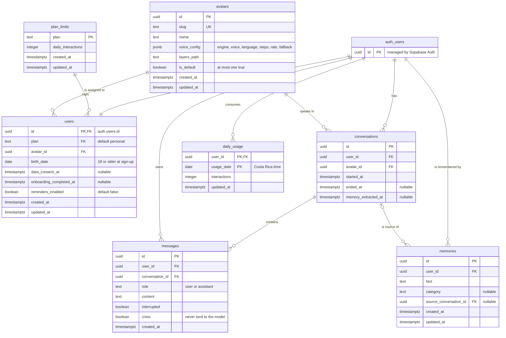

# Entity-relationship diagram — v1

Data model for the marlix MVP, derived from the [user stories](user-stories.md). The SQL that creates it is in [`schema.sql`](schema.sql).

The database is Supabase (PostgreSQL). Sign-up and sign-in are handled by Supabase Auth, which owns the `auth.users` table; every other table lives in the `public` schema.

## Diagram

`auth_users` in the diagram is Supabase's `auth.users` table (Mermaid does not allow dots in entity names).

## Relationships and cardinalities

| Relationship | Cardinality | Notes |
|---|---|---|
| `auth.users` → `users` | 1 to 1 | The profile is created by a trigger on sign-up, which also checks the minimum age. |
| `plan_limits` → `users` | 1 to many | Every user has a plan; v1 has only `personal`. |
| `avatars` → `users` | 1 to many | Every user has an avatar; v1 has only one. |
| `auth.users` → `conversations` | 1 to many | A user has many internal sessions. |
| `avatars` → `conversations` | 1 to many | The avatar the session was held with. |
| `conversations` → `messages` | 1 to many | A message belongs to exactly one session. |
| `auth.users` → `messages` | 1 to many | Denormalized owner, used by RLS and retention. |
| `auth.users` → `memories` | 1 to many | Distilled facts about the user. |
| `conversations` → `memories` | 0..1 to many | The session a fact came from; optional. |
| `auth.users` → `daily_usage` | 1 to many | One row per user per day with activity. |

## Tables

| Table | Purpose | Stories |
|---|---|---|
| `users` | App profile: plan, avatar, birth date, consent, onboarding state and reminders opt-in. | US-01, US-02, US-14 |
| `plan_limits` | Daily interaction cap per plan. | US-10 |
| `avatars` | Avatar catalog: voice settings and SVG layers folder. | US-13 |
| `conversations` | Internal chat sessions. | US-06, US-07 |
| `messages` | Raw chat history, kept for 90 days. | US-03, US-06, US-12 |
| `memories` | Distilled memory added to the system prompt. | US-07, US-08 |
| `daily_usage` | Interactions per user per day. | US-10 |

## Design decisions

### One continuous chat, many sessions

The user sees a single, continuous chat (decided in S0-5). `conversations` stores **internal sessions**, not separate chats: a session ends after a period of inactivity (`ended_at`), and that is when memory extraction runs (US-07). `memory_extracted_at` marks sessions whose memory was already distilled, so the background job can find pending ones. A session ends after 30 minutes without messages, and the function `close_idle_conversations` ends them ([how the memory is built](memory.md)).

### Ready to scale without migrations

Nothing in v2 requires changing the structure, only adding data:

| Today (v1) | Tomorrow (v2) |
|---|---|
| A single avatar in `avatars` | Insert more rows |
| Everyone on `plan = personal` | Add a paid plan in `plan_limits` |
| `avatar_id` points to the only avatar | The user picks another one |

New users get the avatar marked `is_default`, so adding avatars does not change sign-up.

### Birth date and minimum age (S4-3)

The app sends the birth date with the sign-up as user metadata (`birth_date`, `YYYY-MM-DD`). The sign-up trigger copies it to `users.birth_date` and cancels the sign-up, so no account is created, when it is missing, malformed or the person is under 18 on the Costa Rica calendar. Storing the date instead of the age lets the minimum age change later without reworking the model ([decision](decisions.md)). Existing databases get the column from [`migrations/2026-10-15-users-birth-date.sql`](migrations/2026-10-15-users-birth-date.sql).

### Account deletion in cascade

Every table with user data references `auth.users` with `on delete cascade`. Deleting the auth user removes the profile, sessions, messages, memories and usage in one step, with nothing left behind (US-09).

### Messages always match their session's owner

`messages` references `conversations` through the pair `(conversation_id, user_id)`, so a message can never point to another user's session.

### Daily usage in Costa Rica time

`usage_date` defaults to the current date in `America/Costa_Rica`, so the daily cap resets at local midnight, which is what the user is told (US-10).

## Access and Row Level Security

Every table has RLS enabled. The backend connects with the `service_role` key, which bypasses RLS, and is the **only writer** of sessions, messages, memories and usage. That way the crisis filter and the daily cap cannot be skipped by writing to the database from the app.

What a signed-in user (`authenticated`) can do, always limited to their own rows:

| Table | Read | Create | Update | Delete |
|---|---|---|---|---|
| `users` | ✅ | — (trigger) | — (the backend writes consent, onboarding and settings) | — (account deletion) |
| `plan_limits` | ✅ all rows | — | — | — |
| `avatars` | ✅ all rows | — | — | — |
| `conversations` | ✅ | — | — | — |
| `messages` | ✅ | — | — | — |
| `memories` | ✅ | — | Only `fact` | ✅ |
| `daily_usage` | ✅ | — | — | — |

Anonymous users (`anon`) have no access. Column-level grants stop a user from changing their own `plan`, `avatar_id` or `birth_date`.

### Least privilege (S1-8)

RLS decides **which rows** a user reaches; table privileges decide **which operations** exist at all. Supabase grants every privilege to `anon` and `authenticated` by default, and some operations, such as `TRUNCATE`, do not go through RLS. So the schema removes those defaults and grants only what the table above lists:

| Role | Privileges in `public` |
|---|---|
| `anon` | None. |
| `authenticated` | `SELECT` on the seven tables; `UPDATE` only on `memories (fact)`; `DELETE` only on `memories`. Never `INSERT`, `TRUNCATE`, `REFERENCES` or `TRIGGER`. |
| `service_role` (backend) | Unchanged: full access, bypasses RLS. |

- **Functions:** `set_updated_at` and `handle_new_auth_user` run only as triggers, so nobody else can execute them (`public`, `anon` and `authenticated` have no `EXECUTE`). A trigger fires without that privilege.
- **Future tables:** default privileges for `postgres` in `public` are revoked, so a table added by a later migration starts with no access for the app roles until it is granted on purpose.

### Isolation tests (S4-2)

[`schema-test.sql`](schema-test.sql) proves the rules above. It runs in a transaction that is rolled back, so it changes nothing, and it checks these things:

- **Sign-up (S4-3).** A sign-up without a birth date, with another format, with a date that does not exist, or of someone who turns 18 tomorrow is refused and leaves no account behind; someone who turns 18 today can sign up. A user cannot change their birth date.

- **Two users.** Ana and Beto each get a profile, a conversation, messages, a memory and usage, written as the backend would. Acting as Ana the way Supabase does for a request with her token (`request.jwt.claim.sub` and the `authenticated` role), she sees only her rows, her changes on Beto's rows affect nothing, and she cannot insert, truncate or change her plan. `anon` reaches nothing. Deleting Beto removes all his data.
- **Guards on the catalog**, so a later migration cannot slip through: every table in `public` has RLS; every table with user data (a `user_id` column, or `users`) has at least one policy and every one of its policies depends on `auth.uid()`; no policy is open to `anon`. The test also creates a table without RLS to show the guard catches it.

It runs on every pull request in the CI's Database job, against Supabase's Postgres image. To run it against the Supabase project, open the **SQL Editor**, paste the file without its two `psql` lines (`\o /dev/null` and the `\echo`), and run it: it ends in `rollback`, so an error names the failed check and success changes nothing.

## Out of scope

- Creating the real Supabase project (S4-1).
- Crisis activation log without content: for now it is written to the server logs (S2-5, see the [crisis protocol](crisis-protocol.md#activation-log)); a table can replace it once the backend uses the database (Sprint 4).
- Scheduling daily reminders: they are local notifications on the phone (S5-3). The database only stores the opt-in (`reminders_enabled`).

## How to test

Start the local database with Docker (see [Local database](development.md#local-database) in the development guide). On the first start it applies [`schema.sql`](schema.sql) to a clean database; check the seven tables exist.

Then run the privilege and RLS tests in [`schema-test.sql`](schema-test.sql):

~~~bash
docker compose exec -T db psql -U postgres -d postgres -v ON_ERROR_STOP=1 -f - < docs/schema-test.sql
~~~

They check the privileges of each role in the catalog, then act as `anon` and as two signed-in users to confirm that each one only reaches their own rows, that `TRUNCATE` and other operations without privilege are refused, and that deleting an account removes all its data. Everything runs in a transaction that is rolled back. It prints `All database tests passed.` or stops at the first failed check, naming it.

To see the current privileges directly:

~~~sql
select grantee, table_name, privilege_type
from information_schema.role_table_grants
where table_schema = 'public' and grantee in ('anon', 'authenticated')
order by grantee, table_name;
~~~
