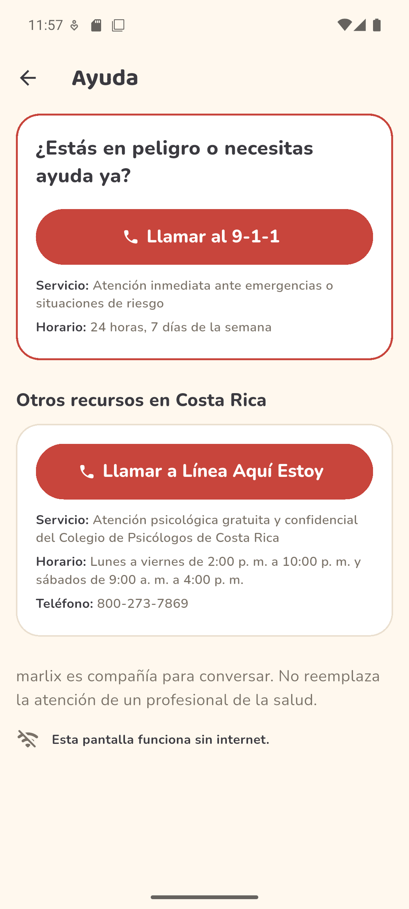
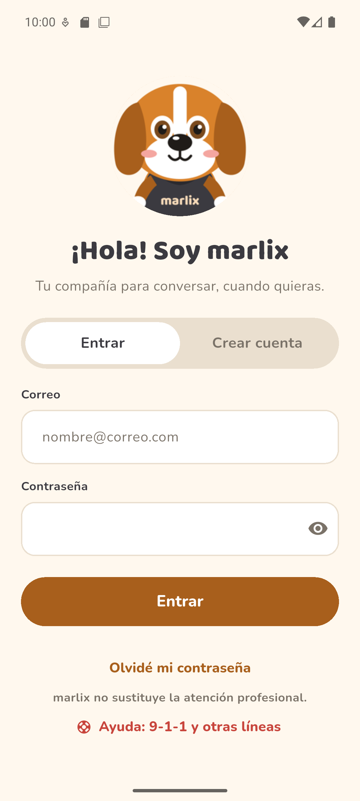
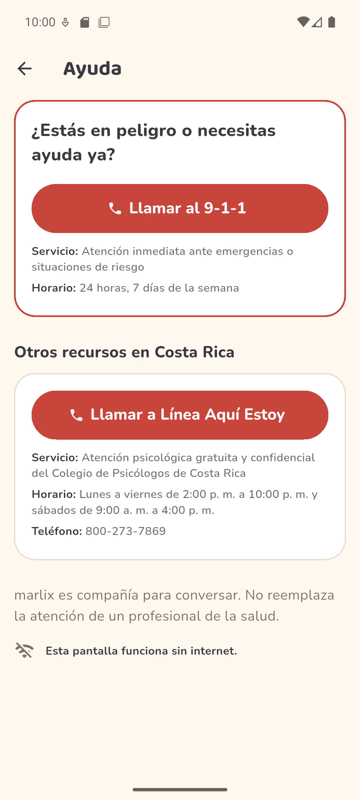

# A0 evidence: Clean Architecture and DDD move

A0 is complete. Local checks ran on 2026-11-25 and staging checks ran on 2026-11-26, and the candidate `a379210` passed both. Production serves the later commit `9ecf7d2` ([production confirmation](#production-confirmation)). That commit passed its [staging verification](#post-deployment-staging-verification-of-9ecf7d2) on 2026-11-28 UTC, after it was already in production.

## Candidate

| Commit | Content |
| --- | --- |
| `c3099a3` | `refactor(api)`: the backend grouped by capability, with a dependency-direction test |
| `9390079` | `refactor(app)`: the app grouped by feature, with a dependency-direction test |
| `a379210` | Documentation: new code paths, retired documents and the execution plan |

The base was `65a0594` on `main`. The candidate was pushed to `release/next-release` on 2026-11-26. The commits from `a379210` to `47aa03f` change only documentation after the candidate, so the API and app code on `main` match the verified candidate.

## Checks

Node 24.21.0 and Flutter 3.47.4, the version CI uses.

| Check | Command | Result |
| --- | --- | --- |
| API types | `npm run typecheck` | Pass |
| API tests | `npm test` | 581 passed, 0 failed |
| API build | `npm run build` | Pass |
| App format | `dart format --output=none --set-exit-if-changed lib test integration_test` | 146 files, 0 changed |
| App analysis | `flutter analyze` | No issues |
| App tests | `flutter test` | 437 passed |
| Release build | `flutter build apk --release --dart-define-from-file=config/staging.json` | Built |

## Behavior

- **API, old and new side by side.** A script booted the `65a0594` build and the candidate build with placeholder credentials and sent the same 19 requests to both (health, help resources, missing and forged tokens, invalid and oversized bodies, unknown routes, and the protected routes). Status, headers (without `date`, `etag` and connection headers) and bodies matched in all 19. Authenticated flows are not covered by this check.
- **Code comparison.** A script compared the code lines of the base and the candidate, ignoring imports and comments. The differences are in wiring and in logic that moved into use cases and domain files: session verification, account deletion, memory listing, extraction policy and transcription.
- **App against staging.** `node tool/verify-integration.mjs staging` on the `Pixel_8` emulator: 12 of 12 passed. The suite calls the API client and does not draw screens. The staging backend runs an earlier commit, so this checks the new app and not the new backend.
- **Release APK on the emulator.** It starts on the sign-in screen and opens the help screen. The log showed no Flutter error and no crash.

## Independent review

A reviewer that did not write the code compared both refactor commits with the base: session checks, the crisis path and its order, usage limits, deletion, data sent to providers, routes, startup wiring and app providers. It found **no blocking behavior change**. It ran the API type check and tests, not the Flutter tests.

Follow-ups it raised, none blocking:

- The app test that limits `package:http` now also allows `composition/` folders and `lib/bootstrap/`.
- The API dependency-direction test has no test of its own, and it checks neither `infrastructure/` layers nor imports between modules.

## Limits and pending

- `9ecf7d2` reached production before its staging verification, which does not meet the order that [decision D12](../plans/execution-plan.md#9-decisions-that-need-the-owner) required.
- The crisis classifier and memory extraction checks ran on `a379210` only. `9ecf7d2` moved the code that wires both, and they were not repeated.
- The message retention job found nothing old enough to delete, so its deletion path did not run in staging. Unit tests cover it.
- The transcription check sent a synthetic tone. It shows the route and the provider answer, not recognition quality.
- Voice mode, chat screens and signed-in screens were not driven by hand.
- `app/pubspec.lock` is not part of the candidate. With Flutter 3.47.4, resolving packages rewrites `test_api` from 0.7.14 to 0.7.12. The change comes from the toolchain, not from the move, and stays uncommitted.
- Seen on the two screens while checking, for Phase 1a to record: the copy mixes voseo with «quieras» and «necesitas» ([#187](https://github.com/WGuillenDev/marlix/issues/187)).

## Main and production follow-up

Checked on 2026-11-26.

| Check | Result |
| --- | --- |
| `git ls-remote --heads origin main release/next-release` | `main` points to `47aa03f` and the candidate branch points to `a379210`. |
| GitHub Actions on `47aa03f` | [CI passed](https://github.com/WGuillenDev/marlix/actions/runs/45775781558). [CodeQL failed](https://github.com/WGuillenDev/marlix/actions/runs/45775781646) in the analysis step for JavaScript/TypeScript and Actions. |
| GitHub production deployment records | No record for the A0 candidate or the current `main` was visible among the latest production entries. Confirm the live commit in Render and check `GET /health` before closing A0. |

## Staging verification

This section covers `a379210` only. The later startup changes in `api/src/bootstrap/` and `app/lib/bootstrap/` are covered by the [local](#local-composition-follow-up) checks, [CI](#production-confirmation) and the [staging verification of `9ecf7d2`](#post-deployment-staging-verification-of-9ecf7d2).

`marlix-api-staging` was deployed by hand with the commit `a379210104c88437f13e9e4ddf427ac331dd63f8`, using the staging database and credentials already configured.

| Check | Result |
| --- | --- |
| Deployed commit | The Render build log reads `Checking out commit a379210104c88437f13e9e4ddf427ac331dd63f8`, and the service shows `a379210` as live. The deployment record that Render sends to GitHub shows the head of `main` instead, so it does not identify a commit deployed by hand |
| Staging script: health, security headers, help resources, protected routes without a token, forged token, malformed JSON, unknown route | Pass |
| Staging script, with a throwaway account: sign-up, profile, onboarding (refused without consent, accepted once, refused twice), streamed voice reply, one interaction counted, streamed crisis reply, history, transcription (two refusals and one accepted clip), account deletion, no sign-in after deletion | Pass, 26 of 26 checks in total with the row above |
| `node tool/verify-integration.mjs staging` on `Pixel_8` | 12 of 12 passed |
| Crisis classifier | A harmless ambiguous message got a normal reply. An ambiguous risk message got the crisis reply, and the log shows the `classifier` layer |
| Memory extraction | No memory before the idle window. After it, the background job added 2 facts, one about the synthetic message. The account was then deleted |
| Service logs from the deploy to the end of the checks | No error. They show crisis activations and the extraction count, with no message text |

## Local composition follow-up

Checked on 2026-11-26 after moving API assembly to `api/src/bootstrap/` and Flutter startup to `app/lib/bootstrap/`. These checks apply to the local follow-up. The staging and production records above apply to their recorded commits.

| Check | Result |
| --- | --- |
| API typecheck and build | `npm run typecheck` and `npm run build` passed. |
| API tests | `npm test` passed all 581 tests, including the import boundary check. |
| Compiled API startup | `dist/server.js` with stubbed external requests returned 200 for health and help resources and 401 for `/v1/me` without a session. Startup invoked the background jobs and the shutdown handler exited successfully. |
| App format and analysis | `dart format --output=none --set-exit-if-changed lib` reported zero changes. `flutter analyze --no-pub` reported no issues. |
| App tests | `flutter test --no-pub --reporter expanded` passed all 437 tests. |

## Production confirmation

Dated 2026-11-28 UTC. The Render and health results come from an independent read-only check. The workflow results and the remote branch were also read from GitHub by the session that wrote this section.

| Check | Result |
| --- | --- |
| Commit served by Render in production | `9ecf7d28b5871fcf560b209d922da77f9e53f47a` |
| `GET /health` in production | HTTP 200, twice |
| `git ls-remote --heads origin main` | `9ecf7d28b5871fcf560b209d922da77f9e53f47a` |
| GitHub Actions for that commit | [CI passed](https://github.com/WGuillenDev/marlix/actions/runs/45893691482). [CodeQL passed](https://github.com/WGuillenDev/marlix/actions/runs/45893691464) |

## Post-deployment staging verification of `9ecf7d2`

This validation ran after the production deploy. Production served `9ecf7d2` from 2026-11-26 20:52:14 UTC. Staging received the same commit on 2026-11-28 at 02:52:09 UTC, by a manual deploy that the owner approved. [Decision D12](../plans/execution-plan.md#9-decisions-that-need-the-owner) required staging verification before the push to `main`.

The checks below ran on 2026-11-28 between 03:56 and 04:02 UTC.

| Check | Result |
| --- | --- |
| Deployed commit | The Render build log reads `Checking out commit 9ecf7d28b5871fcf560b209d922da77f9e53f47a`. Before the checks, it was still the latest staging deploy |
| `GET /health` in staging | HTTP 200 with `{"status":"ok"}` after the deploy, before the checks and after them |
| Staging script, the same one used for `a379210` | 26 of 26 checks passed: the unauthenticated routes, and the throwaway account flow from sign-up to deletion |
| `node tool/verify-integration.mjs staging` on `Pixel_8` | 12 of 12 passed |
| Release APK built with `flutter build apk --release --no-pub --dart-define-from-file=config/staging.json` | Built, version 0.1.2, SHA-256 `92c2f1a674332383ad0666b1b2d6a5ade6208e28a153596c79d5cef3056a7f62` |
| Release APK on `Pixel_8`, with app data cleared | It started on the sign-in screen and opened the help screen. No call button was pressed. The log showed no Flutter error and no crash |
| Staging application logs, last hour at 04:01 UTC | No error. They show a server start and two crisis activations from the keyword layer, with no message text |
| API checks | `npm run typecheck` and `npm run build` passed. `npm test` passed all 581 tests |
| App checks | `dart format` reported 147 files and 0 changes. `flutter analyze --no-pub` reported no issues. `flutter test --no-pub` passed all 437 tests |

The app and API builds and tests ran on a checkout whose files outside `docs/` match `9ecf7d2`, except for the uncommitted `app/pubspec.lock` rewrite described under [Limits and pending](#limits-and-pending).

