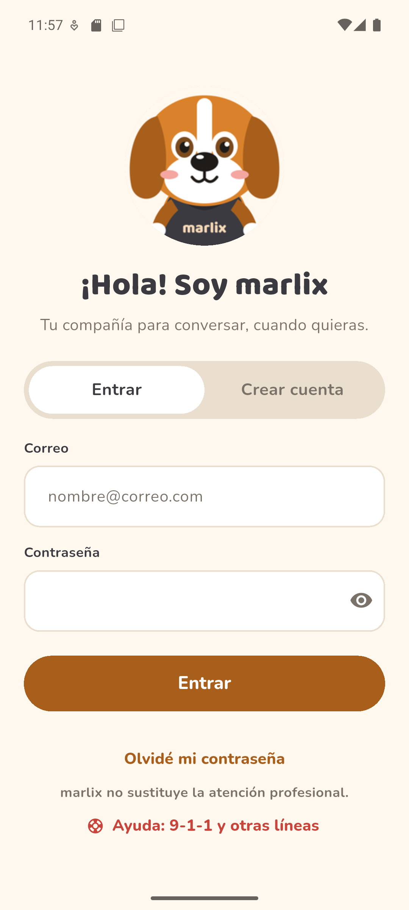

# A0 evidence: Clean Architecture and DDD move

Local checks run on 2026-11-25, staging checks on 2026-11-26. Result: **the candidate `a379210` passes both. A0 stays open until that code is on `main` and the production deploy is confirmed** ([decision D12](../plans/next-release-execution-plan.md#decisions-that-need-the-owner)).

## Candidate

| Commit | Content |
| --- | --- |
| `c3099a3` | `refactor(api)`: the backend grouped by capability, with a dependency-direction test |
| `9390079` | `refactor(app)`: the app grouped by feature, with a dependency-direction test |
| `a379210` | Documentation: new code paths, retired documents and the execution plan |

The base is `65a0594` (`origin/main`). The candidate was pushed to `release/next-release` on 2026-11-26. The commits after `a379210` change only documentation, so `api/` and `app/` in the final candidate are the ones that were verified.

## Checks

Node 24.21.0 and Flutter 3.47.4, the version CI uses.

| Check | Command | Result |
| --- | --- | --- |
| API types | `npm run typecheck` | Pass |
| API tests | `npm test` | 581 passed, 0 failed |
| API build | `npm run build` | Pass |
| App format | `dart format --output=none --set-exit-if-changed lib test integration_test` | 146 files, 0 changed |
| App analysis | `flutter analyze` | No issues |
| App tests | `flutter test` | 437 passed |
| Release build | `flutter build apk --release --dart-define-from-file=config/staging.json` | Built |

## Behavior

- **API, old and new side by side.** A script booted the `65a0594` build and the candidate build with placeholder credentials and sent the same 19 requests to both (health, help resources, missing and forged tokens, invalid and oversized bodies, unknown routes, and the protected routes). Status, headers (without `date`, `etag` and connection headers) and bodies matched in all 19. Authenticated flows are not covered by this check.
- **Code comparison.** A script compared the code lines of the base and the candidate, ignoring imports and comments. The differences are in wiring and in logic that moved into use cases and domain files: session verification, account deletion, memory listing, extraction policy and transcription.
- **App against staging.** `node tool/verify-integration.mjs staging` on the `Pixel_8` emulator: 12 of 12 passed. The suite calls the API client and does not draw screens. The staging backend runs an earlier commit, so this checks the new app and not the new backend.
- **Release APK on the emulator.** It starts on the sign-in screen and opens the help screen. The log showed no Flutter error and no crash.

## Independent review

A reviewer that did not write the code compared both refactor commits with the base: session checks, the crisis path and its order, usage limits, deletion, data sent to providers, routes, startup wiring and app providers. It found **no blocking behavior change**. It ran the API type check and tests, not the Flutter tests.

Follow-ups it raised, none blocking:

- The app test that limits `package:http` now also allows `composition/` folders and `lib/bootstrap/`.
- The API dependency-direction test has no test of its own, and it checks neither `infrastructure/` layers nor imports between modules.

## Limits and pending

- The new backend has run in staging only, not in production.
- The message retention job found nothing old enough to delete, so its deletion path did not run in staging. Unit tests cover it.
- The transcription check sent a synthetic tone. It shows the route and the provider answer, not recognition quality.
- Voice mode, chat screens and signed-in screens were not driven by hand.
- `app/pubspec.lock` is not part of the candidate. With Flutter 3.47.4, resolving packages rewrites `test_api` from 0.7.14 to 0.7.12. The change comes from the toolchain, not from the move, and stays uncommitted.
- Seen on the two screens while checking, for Phase 1a to record: the copy mixes voseo with «quieras» and «necesitas» ([#187](https://github.com/WGuillenDev/marlix/issues/187)).
- CI has not run on these commits. It runs on pushes to `main` and on pull requests.

## Staging verification

`marlix-api-staging` was deployed by hand with the commit `a379210104c88437f13e9e4ddf427ac331dd63f8`, using the staging database and credentials already configured.

| Check | Result |
| --- | --- |
| Deployed commit | The Render build log reads `Checking out commit a379210104c88437f13e9e4ddf427ac331dd63f8`, and the service shows `a379210` as live. The deployment record that Render sends to GitHub shows the head of `main` instead, so it does not identify a commit deployed by hand |
| Staging script: health, security headers, help resources, protected routes without a token, forged token, malformed JSON, unknown route | Pass |
| Staging script, with a throwaway account: sign-up, profile, onboarding (refused without consent, accepted once, refused twice), streamed voice reply, one interaction counted, streamed crisis reply, history, transcription (two refusals and one accepted clip), account deletion, no sign-in after deletion | Pass, 26 of 26 checks in total with the row above |
| `node tool/verify-integration.mjs staging` on `Pixel_8` | 12 of 12 passed |
| Crisis classifier | A harmless ambiguous message got a normal reply. An ambiguous risk message got the crisis reply, and the log shows the `classifier` layer |
| Memory extraction | No memory before the idle window. After it, the background job added 2 facts, one about the synthetic message. The account was then deleted |
| Service logs from the deploy to the end of the checks | No error. They show crisis activations and the extraction count, with no message text |
